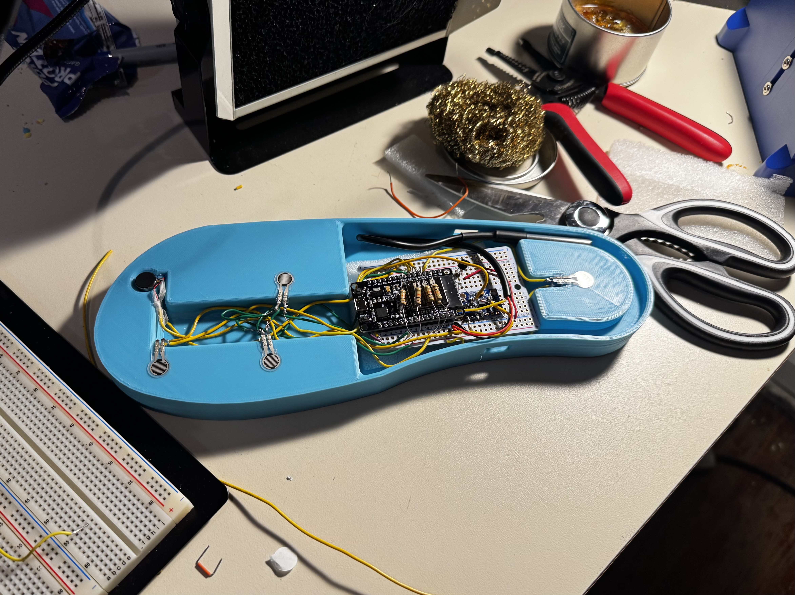
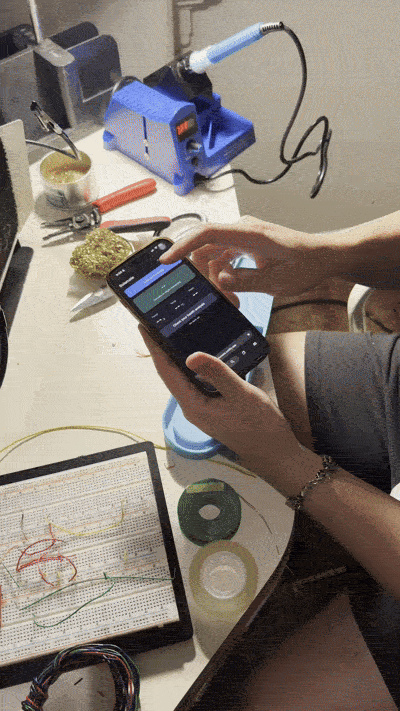
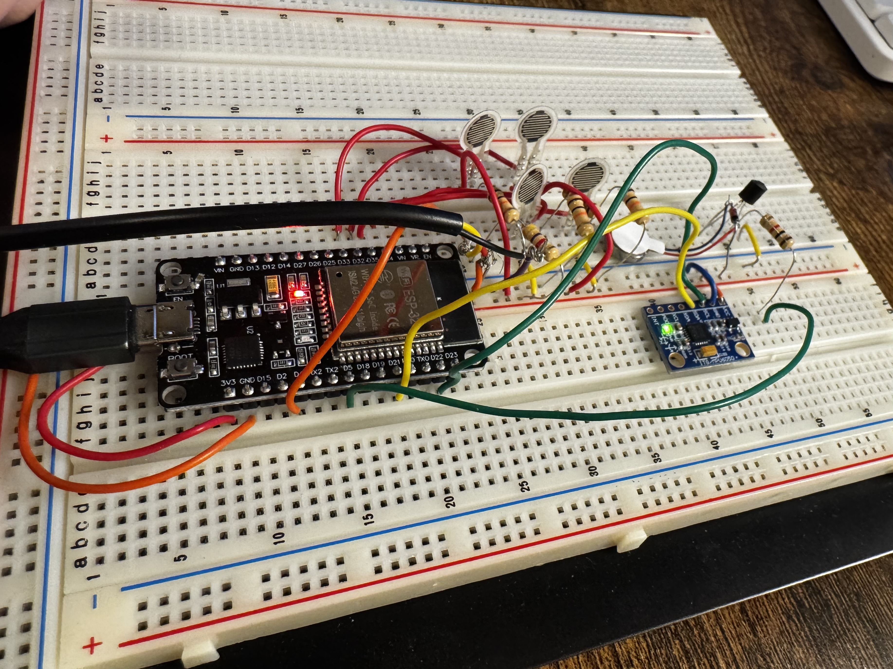
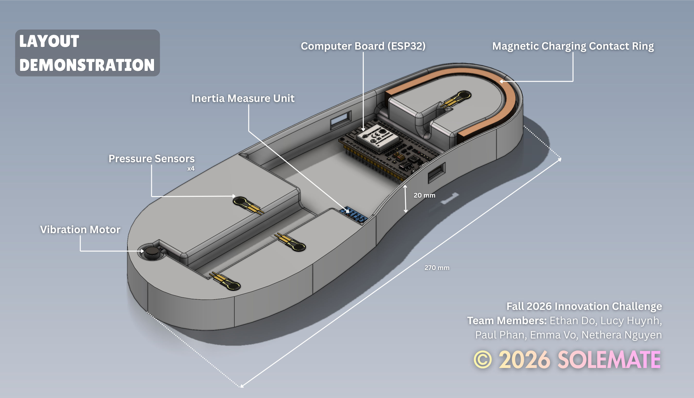
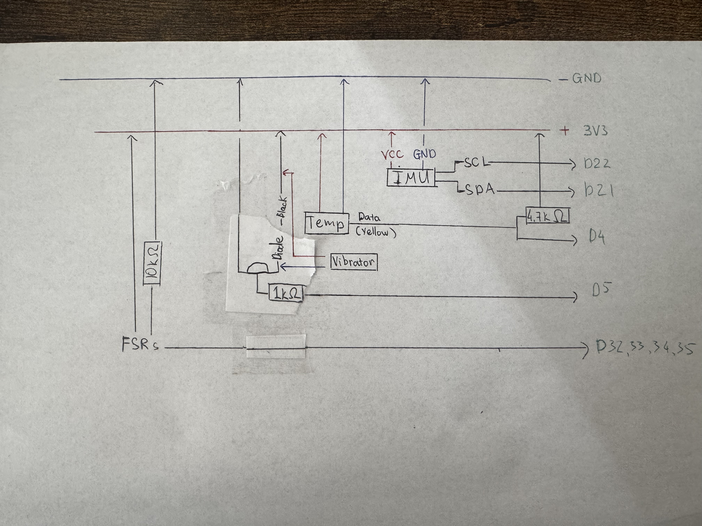
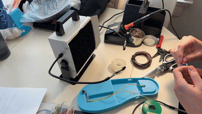

# Solemate

A smart insole prototype that detects falls and tracks foot pressure and temperature, built for the Fall 2026 UC CEAS Innovation Challenge.




## Problem and goal

Falls are a leading cause of injury and death for older adults, and many falls at home happen when nobody is around to help. People with diabetes who lose feeling in their feet face two risks: they fall more easily, and they may not notice foot wounds or inflammation until it becomes serious.

Common devices like SOS wristbands, cameras, and bed sensors are easy to forget, have blind spots, raise privacy concerns, or only react after something has happened.

**Goal:** an insole that slips into the user's own shoes and:
1. Detects a fall and sends an alert if the user does not respond.
2. Watches for a lasting temperature difference between the left and right foot, an early warning sign of diabetic foot problems.

## Hardware and software used

### Current prototype (one foot, breadboard, USB powered)


| Part | Use | ESP32 pin |
| --- | --- | --- |
| ESP32 dev board | Main controller, built-in Bluetooth Low Energy (BLE) | |
| MPU6050 (IMU) | Measures acceleration for fall detection and step counting | SDA 21, SCL 22 |
| 4 x FSR pressure sensors | Heel, inner ball, outer ball, big toe | 34, 32, 33, 35 |
| DS18B20 temperature sensor | Foot temperature | GPIO 4 |
| Vibration motor + transistor driver | Buzzes to warn the user | 5 |

### Planned for the wearable version (designed, not built)

- XIAO ESP32-S3 in place of the dev board, to fit inside an insole
- LiPo battery with TP4056 charging circuit, PTC fuse
- Bedside charging dock: heel prongs touch gold-plated pads on the insole, keyed magnets handle alignment and polarity
- Insole-shaped custom PCB with the ESP32 module mounted on it
- Second insole for the left and right temperature comparison

### Software and tools

- Arduino IDE (C++ firmware for the ESP32)
- Wokwi (circuit simulation before building on hardware)
- Web Bluetooth dashboard (single HTML file), hosted with Netlify Drop
- Bluefy browser on iPhone (Safari does not support Web Bluetooth)
- EmailJS (sends the SOS email from the dashboard)
- SolidWorks (insole and enclosure CAD)

## How it works



1. **Sense.** The ESP32 reads the IMU, the 4 pressure sensors, and the temperature sensor.
2. **Detect a fall.** A fall is a sudden spike above 2.5 g followed by about 2 seconds of stillness. If the user keeps moving within 15 seconds after the spike, it is treated as a stumble, not a fall.
3. **Warn.** The motor vibrates and a countdown starts on the phone. The user can cancel it in the dashboard.
4. **Alert.** If the countdown runs out, the dashboard shows "SOS sent" and sends an email alert.
5. **Monitor.** The dashboard shows live force, temperature, steps, a foot pressure map, and graphs. The firmware also checks for a temperature gap between two sensors that stays above 2.0 °C.

Demo settings: the countdown is 10 seconds (target is 30) and the temperature gap only has to hold for 10 seconds (target is 24 to 32 hours), so both can be shown live.

## Results

### Dashboard


Tested on the bench by hand (shaking or tapping the IMU, pressing the sensors). No tests with real falls, real users, or shoes.

| Requirement | Result | Notes |
| --- | --- | --- |
| Detect a fall (spike above 2.5 g, then stillness) | Achieved | Works in Wokwi and on hardware. Bench tested only. |
| Vibration warning on a fall | Achieved | Motor buzzes on hardware. |
| Countdown before SOS, cancel option | Partial | Works with a 10 s demo value, not the 30 s target. |
| Cancel the alert from the phone | Not tested | Cancel button built into the dashboard; no test result recorded. |
| Send an emergency alert | Partial | Email sends from the dashboard after fixing a wrong Template ID. Arrival in the inbox not confirmed. No SMS or phone call. |
| Include GPS location in the alert | Not tested | Not built. The email has time and impact force only. |
| Multi-point pressure sensing | Achieved | 4 FSRs on hardware, shown on a live foot pressure map. |
| Foot temperature reading | Achieved | 1 DS18B20 on hardware. |
| Left vs right temperature gap warning | Partial | Works in Wokwi with 2 sensors (2.0 °C gap, 10 s hold). Hardware has one foot only. |
| Stream data to a phone over Bluetooth | Achieved | ESP32 to iPhone through Bluefy. |
| Step counting | Not tested | Simple peak counter added to firmware; no result recorded. |
| Fall risk score, gait analysis, on-device ML | Not tested | Not built. Plan is to run ML on a phone or laptop first. |
| Under 3 mm thick at sensor zones | Not achieved | Current CAD prototype is 20 mm tall, a bench demo, not wearable. |
| Battery and charging dock | Not tested | Designed, not built. Prototype runs on USB. |
| Water resistance | Not tested | Not built. |
| Works on both feet | Not tested | Only one foot built. |

## Testing and Data Logging

### Automated tests
The fall-detection rules from `firmware/hardware/Solemate.ino` are mirrored in a Python model (`tests/fall_detect.py`) and checked with Pytest. Tests cover:
- Impact threshold (above 2.5 g)
- Stillness band (0.8 to 1.2 g, inclusive) and the "more than 2 s" rule
- The 15 s give-up timer after an impact
- Parsing of the ESP32 serial output, including broken lines

Tests run automatically on every push through GitHub Actions.

    py -m pip install pytest
    py -m pytest -v

> Note: the tests check the Python model, not the C++ firmware directly. If the firmware thresholds change, `tests/fall_detect.py` must be updated to match.

### Data logging
`datalog/` records test sessions from the ESP32 over USB into a SQLite database, then analyzes them with SQL.

| File | Purpose |
|---|---|
| `parse.py` | Turns one serial line into data (readings or events) |
| `db.py` | Creates the database: `sessions`, `readings`, `events` |
| `logger.py` | Logs a live session from the device, or from a fake file |
| `queries.py` | SQL analysis: detections vs real falls, false alarms, pressure, temperature |
| `make_fake.py` | Generates fake sessions for testing without hardware |

**Log a session** (press Ctrl+C to stop):

    py -m pip install pyserial
    py datalog\logger.py --label walking --port COM4
    py datalog\logger.py --label fake_fall --real-fall --port COM4

**Analyze:**

    py datalog\queries.py

Each session records whether a fall was actually staged (`--real-fall`), so the queries can compare what really happened against what the device detected.

### Results
Testing in progress. Results will be added after the real test sessions.

## What I learned

- **Start from the real power budget.** Piezoelectric harvesting from walking cannot power the insole on its own, so I switched to a battery with a charging circuit and a charging dock.
- **Check the parts before adding more.** The ESP32 already has Bluetooth, so a separate Bluetooth module was not needed.
- **A PCB and a microcontroller are different things.** The PCB is the wiring board; the ESP32 is the processor. The final insole needs both.
- **Keep the first prototype simple.** Running ML on the insole can wait; prove the sensors and alerts first.
- **Cheap FSRs are fine for a prototype**, but their readings are better compared to the user's own baseline than to fixed pressure limits.
- **Debugging skills:** installing the CP2102 USB driver, a pin label mix-up that made the temperature read -127, upload stalls fixed with the BOOT button, and a wrong EmailJS Template ID that caused a 400 error.
- **Phone limits matter.** Safari on iPhone does not support Web Bluetooth, so the demo uses the Bluefy browser.

## My role



I am the lead engineer. I built the working prototype. I simulated the circuit in Wokwi, wired and tested the ESP32 and sensors on a breadboard, wrote and debugged the firmware, set up the Bluetooth dashboard with the fall alert and email, and worked on the insole layout and CAD in SolidWorks.

Team members: Ethan Do, Lucy Huynh, Nethera Nguyen, Emma Vo, and Paul Phan.

## Repo layout

```
firmware/    ESP32 sketches (hardware build, Wokwi simulation)
dashboard/   Web Bluetooth dashboard
cad/         SolidWorks files and STL exports
docs/        proposal deck and project document
media/       photos, videos, diagrams
```
